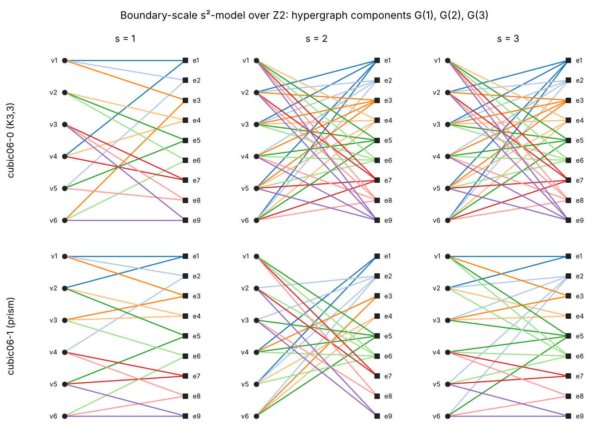

# s2-models — Topological scale framework for hypergraphs

[](https://github.com/hmabril-sketch/s2-models/actions/workflows/tests.yml)

Python implementation of the scale-space topological models (**s²-models**) and
of the graph isomorphism experiments of

> H. Molina-Abril, M.J. Morón-Fernández, M. Benito-Marimón, F. Díaz-del-Río, P. Real.
> **Topological scale framework for hypergraphs.**
> *Applied Mathematics and Computation* 485 (2025) 128989.
> [doi:10.1016/j.amc.2024.128989](https://doi.org/10.1016/j.amc.2024.128989)

An s²-model of a hypergraph *G* is a sequence of algebraic hypergraphs
(1-dimensional chain complexes) *G(1) = C\*(G), G(2), G(3), …*, all with the
Euler–Poincaré characteristic of *G*, linked by transition chain maps
ρ⁺(s): G(s) → G(s+1) and ρ⁻(s): G(s) → G(s−1). Both the model and its homology
are hypergraph isomorphism invariants (Theorem 3), which yields certificates
able to separate graphs that defeat Weisfeiler–Leman tests.



## Contents

| Paper | Code |
|---|---|
| Cellular hypergraphs, *m(G)*, *g(G)*, hypergraph maps and isomorphisms (§3.1, Defs. 1–3) | `s2models/hypergraph.py` — `Hypergraph` |
| Coefficient rings *F* = Z, Z/p (§3.3) | `s2models/rings.py` |
| Chain complexes, chain maps, homology via Smith Normal Form (§3.3, Appendix A) | `s2models/chain.py`, `s2models/linalg.py` |
| s²-models and axioms S2.1–S2.5 (Def. 4) | `s2models/models.py` — `S2Model.verify()` |
| Adjacency models: trivial, colour refinement (CR), iterated Laplacians (§4.1) | `TrivialAdjacencyModel`, `ColorRefinementModel`, `IteratedLaplacianModel` |
| Incidence models: change of basis, **boundary-scale model** (§4.2, Def. 7) | `BasisChangeModel`, `BoundaryScaleModel` |
| Homology s²-model H(S²(G)) with induced maps [ρ±(s)]_H (§5, Def. 8) | `s2models/homology_model.py` — `HomologyS2Model` |
| Intra / inter / hybrid s²-HI certificates, ω_d, ω_β, ω_i, ω_ρ+, ω_ρ- (§6) | `s2models/invariants.py` |
| Experiments of §6.1 (Tables 2–5) | `experiments/run_experiments.py` |
| Running example (Figs. 1, 2, 3, 5) | `examples/paper_example.py`, `tests/test_paper_example.py` |
| Table 1 (connectivity representation of the levels) | `examples/plot_levels.py` |

## Installation

```bash
git clone https://github.com/hmabril-sketch/s2-models.git
cd s2-models
pip install -e ".[all]"      # numpy, networkx, cypari2, matplotlib, pytest
```

The only hard dependencies are `numpy` and `networkx`. `cypari2` (PARI/GP)
provides a fast exact Smith Normal Form and is needed for the experiments on
large graphs (the strongly regular graphs require the SNF of 315 × 315 integer
matrices); without it a pure-Python SNF is used.

## Quick start

```python
from s2models import Hypergraph, BoundaryScaleModel, isomorphism_test

# The hypergraph of Fig. 1: edges given by their boundaries {vertex: degree of contact}
G = Hypergraph.from_edges(6, [{1: 1, 2: 3}, {}, {1: 3, 3: 1, 4: 1}, {3: 1},
                              {3: 2, 4: 1, 5: 1}], one_based=True)

model = BoundaryScaleModel(G, ring="Z2")      # M(s) = M (MᵀM)^(s-1) over Z2
model.boundary(2)                              # incidence matrix of G(2) (Fig. 5)
model.rho_plus(2).f0                           # ρ+(2) = (Z2[∂δ], 1)
[model.level(s).betti_numbers() for s in (1, 2, 3)]   # [(2, 1), (3, 2), (4, 3)]
model.verify(3)                                # axioms S2.1–S2.5 -> all True
print(model.homology().summary(3))             # H(S²(G)) and the maps [ρ+(s)]_H

# Isomorphism test with the truncated model S²_3
import networkx as nx
isomorphism_test(nx.complete_bipartite_graph(3, 3), nx.circular_ladder_graph(3))
# -> non-isomorphic (certified by i at level s=1)
```

`examples/isomorphism_test.py` separates the Shrikhande graph from the 4×4
rook's graph (two 3-WL-equivalent strongly regular graphs).

## Reproducing the experiments (Section 6.1)

```bash
python scripts/download_data.py                 # graph6 files -> data/ (checksummed)
python experiments/run_experiments.py           # all families, k = 3, ring Z2
python experiments/run_experiments.py --family cubic      # only Table 3 (seconds)
```

The script builds the truncated boundary-scale model S²₃ over Z2 for every
graph, computes the five metrics at every scale and reports, for each
dataset, the percentage of graphs whose certificate is shared with no other
graph. Features are cached in `results/cache/`; `--tables-only` regenerates
the tables from the cache. On a 2-core machine the cubic and Cayley families
take under a minute; the strongly regular family takes about 30 minutes
(dominated by `sr351899` and `sr361446`).

Outputs: `results/results_Z2_k3.md` (tables with the paper's values next to
ours), `results/per_metric_Z2_k3.csv` and `results/per_level_Z2_k3.csv`.

## Results

RESULTS_PLACEHOLDER

## Implementation notes

The paper leaves a few details implicit. The choices below were fixed by
checking them against the published tables (the alternatives reproduce
clearly fewer cells):

1. **Rings.** The s²-models are built over **Z2** (all products reduced mod 2,
   as in Fig. 5); the Smith Normal Forms used by ω_i, ω_ρ+ and ω_ρ- are then
   computed over **Z** on those 0/1 matrices (§6.1: "SNF is applied … using
   the integers Z as ground ring"). Building the model over Z instead does
   not reproduce Table 3: ω_ρ+ and ω_ρ- then separate at least 93 % of every
   cubic dataset, against 0–100 % (37 % for cubic14) in the paper.
2. **Exponent of the boundary-scale model.** Definition 7 writes ∂(δ∂)ˢ; we
   use the matrix form given right after it, M(s) = M (MᵀM)^(s−1), which is
   the one consistent with S2.1 (G(1) = C\*(G)) and with Fig. 5.
3. **ω_i** is the sorted list of the diagonal entries of the SNF that are
   different from 1, *including the zeros* (so it also records the rank of
   M(s) over Q). Dropping the zeros reproduces only 2 of the 5 cubic values.
4. **Transition metrics in a truncated model.** S²_k contains G(1), …, G(k) and
   the maps between them, so ω_ρ+ and ω_ρ- use the composites of length
   1, …, k−1: ρ⁺(1), ρ⁺(2)∘ρ⁺(1) and ρ⁻(2), ρ⁻(2)∘ρ⁻(3) for k = 3, i.e. the
   SNFs of (MMᵀ)ʲ and (MᵀM)ʲ, j = 1, 2 (the identity components are trivial).
   With this reading ω_ρ+ and ω_ρ- match the paper in every cubic dataset,
   and Table 2 at s = 1 matches (no transition map is available at k = 1).
5. **ω_d** is the per-scale sorted sequence of vertex degrees
   |v| = #{e : I(v, e) ≠ 0} of G(1), G(2), G(3).
6. **Datasets.** Cayley graphs are grouped by (|V|, |E|); the counts coincide
   with Table 5. Groups with a single graph are dropped. The 36-vertex Cayley
   groups are present in the source files but not in the paper; run them with
   `--extra-cayley`.

## Tests

```bash
pytest -q
```

The suite checks the paper's running example entry by entry (Figs. 1, 3, 5
and the Betti numbers of §4.2), the SNF factorisations over Z and Z/p, the
axioms S2.1–S2.5 for every model over Z, Z2 and Z3, functoriality of the
induced homology maps, invariance of all certificates under random
relabellings of vertices and edges (Theorem 3), and the Shrikhande / rook
example of Table 4.

## Repository layout

```
s2models/              library
  hypergraph.py        cellular hypergraphs (Defs. 1–3)
  rings.py, linalg.py  coefficient rings, Smith Normal Form, ranks
  chain.py             chain complexes, chain maps, homology (Appendix A)
  models.py            s²-models (Defs. 4–7)
  homology_model.py    H(S²(G)) (Def. 8)
  invariants.py        certificates and isomorphism tests (§6)
  datasets.py          benchmark loaders / downloader
experiments/           run_experiments.py, paper_results.py (Tables 2–5 of the paper)
examples/              paper_example.py, isomorphism_test.py, plot_levels.py
scripts/               download_data.py
results/               reproduced tables (Markdown + CSV) and figures
tests/                 pytest suite
```

## Data

The benchmark graphs are not stored here; `scripts/download_data.py` fetches
them from a pinned commit of
[aidos-lab/PH_expressivity](https://github.com/aidos-lab/PH_expressivity)
(Ballester & Rieck, LoG 2024), which redistributes connected cubic graphs
(nauty `geng`), minimal Cayley graphs ([House of Graphs](https://houseofgraphs.org))
and strongly regular graphs
([B. McKay's collection](https://users.cecs.anu.edu.au/~bdm/data/graphs.html)).
See `data/README.md`.

## Citation

```bibtex
@article{MolinaAbril2025s2,
  title   = {Topological scale framework for hypergraphs},
  author  = {Molina-Abril, H. and Mor{\'o}n-Fern{\'a}ndez, M.J. and Benito-Marim{\'o}n, M.
             and D{\'i}az-del-R{\'i}o, F. and Real, P.},
  journal = {Applied Mathematics and Computation},
  volume  = {485},
  pages   = {128989},
  year    = {2025},
  doi     = {10.1016/j.amc.2024.128989}
}
```

## License

Code released under the MIT License (see `LICENSE`).
